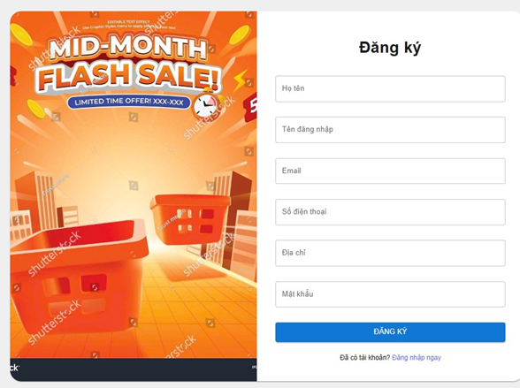

# Tài liệu hướng dẫn sử dụng — Electro Store

Tài liệu mô tả **từng bước** các chức năng trên website Electro Store dành cho:

| Đối tượng | Nội dung |
|-----------|----------|
| **Khách hàng** | Phần A — đăng ký/đăng nhập, mua sắm, đơn hàng, bảo hành, chatbot… |
| **Admin / nhân viên** | Phần B — dashboard, sản phẩm, đơn hàng, kho, thống kê… |

> **Ghi chú chèn ảnh:** Thư mục ảnh mẫu: `docs/images/user-guide/`. Các mục còn lại dùng placeholder `[Chèn Hình ảnh …]` — hãy chụp màn hình đầy đủ giao diện thực tế và thay thế placeholder.

---

# PHẦN A — HƯỚNG DẪN NGƯỜI DÙNG (KHÁCH HÀNG)

---

## 1.1. Đăng ký, Đăng nhập và Quản lý định danh

Khởi tạo tài khoản là chìa khóa để theo dõi đơn hàng, lưu địa chỉ, yêu thích sản phẩm và sử dụng đầy đủ tiện ích mua sắm.

**Bước 1 (Đăng ký tài khoản mới):** Tại góc trên bên phải Trang chủ, nhấn nút **Đăng nhập** (màu đỏ). Ở trang đăng nhập, chọn liên kết **Đăng ký ngay**.

**Bước 2:** Form **Đăng ký** xuất hiện (cột phải). Nhập lần lượt: **Họ tên**, **Tên đăng nhập**, **Email**, **Số điện thoại**, **Địa chỉ**, **Mật khẩu**. Nhấn nút **Đăng ký**.

**Bước 3 (Đăng nhập):** Quay lại trang **Đăng nhập**. Chọn tab **Mật khẩu**, nhập **Email** và **Mật khẩu**, có thể bật **Ghi nhớ đăng nhập**, rồi nhấn **Đăng nhập**. Bạn cũng có thể đăng nhập nhanh bằng **Google** hoặc **Facebook** phía dưới form.

**Bước 4 (Đăng nhập bằng mã QR):** Chọn tab **Mã QR**. Mở trình duyệt trên điện thoại (cùng mạng Wi‑Fi nếu dùng IP LAN), vào đường dẫn quét QR của hệ thống (`/scan-qr`), quét mã đang hiển thị trên máy tính. Phiên đăng nhập sẽ tự kích hoạt khi quét thành công.

**Bước 5 (Quên mật khẩu):** Trên form đăng nhập, nhấn **Quên mật khẩu?**. Nhập email đã đăng ký → gửi yêu cầu → mở email và đặt lại mật khẩu theo hướng dẫn.



> **Hình 1.1:** Giao diện Đăng ký chia 2 cột (banner khuyến mãi bên trái, form bên phải). Các trường: Họ tên, Tên đăng nhập, Email, Số điện thoại, Địa chỉ, Mật khẩu. Nút **Đăng ký** và liên kết **Đã có tài khoản? Đăng nhập ngay**.

[Chèn Hình ảnh 1.1b: Màn hình Đăng nhập — 2 tab Mật khẩu / Mã QR; nút Google & Facebook phía dưới; liên kết Quên mật khẩu và Đăng ký ngay.]

---

## 1.2. Trang chủ và điều hướng chung

Trang chủ giúp khách nhanh chóng tìm sản phẩm, xem khuyến mãi và chuyển sang các mục thông tin.

**Bước 1:** Mở website Electro Store. Thanh Header gồm: **Logo**, **ô tìm kiếm** (có lọc danh mục), **Yêu thích**, **Giỏ hàng**, **Đổi ngôn ngữ** (VI/EN), **Tài khoản**.

**Bước 2:** Dùng menu điều hướng: **Trang Chủ**, **Cửa Hàng**, **Thông Tin** (Về chúng tôi, Tra cứu bảo hành, Hỏi đáp, Tin tức, Chat với nhân viên, Điều khoản, Liên hệ).

**Bước 3:** Cuộn trang chủ để xem banner, danh mục nổi bật và các khối sản phẩm / gợi ý (nếu hệ thống AI đang chạy).

[Chèn Hình ảnh 1.2: Trang chủ đầy đủ — Header, banner, danh mục, khối sản phẩm.]

---

## 1.3. Tìm kiếm và duyệt cửa hàng

**Bước 1:** Trên Header, chọn danh mục (Tất cả / Phụ kiện / Máy tính / Điện thoại…), gõ từ khóa vào ô tìm kiếm. Gợi ý sản phẩm hiện khi gõ ≥ 2 ký tự.

**Bước 2:** Nhấn biểu tượng tìm kiếm (cam) hoặc Enter → chuyển sang trang **Cửa hàng** (`/shop`) với kết quả lọc theo từ khóa / danh mục.

**Bước 3:** Trên trang Cửa hàng, lọc thêm theo giá, thương hiệu, sắp xếp nếu có; nhấn thẻ sản phẩm để xem chi tiết.

[Chèn Hình ảnh 1.3: Ô tìm kiếm có autocomplete và trang danh sách sản phẩm Cửa hàng.]

---

## 1.4. Chi tiết sản phẩm, Yêu thích và Thêm vào giỏ

**Bước 1:** Vào trang chi tiết sản phẩm. Xem ảnh, giá, mô tả, biến thể (RAM/dung lượng/màu… nếu có).

**Bước 2:** Chọn biến thể và số lượng (nếu có). Nhấn **Thêm vào giỏ** (cần đăng nhập để lưu giỏ trên server).

**Bước 3:** Nhấn biểu tượng trái tim để thêm / bỏ khỏi **Yêu thích**. Xem danh sách yêu thích qua icon trái tim trên Header (`/wishlist`).

**Bước 4:** Cuộn xuống mục **Đánh giá** để đọc review của khách khác (và gửi đánh giá khi đủ điều kiện).

[Chèn Hình ảnh 1.4: Trang chi tiết sản phẩm — ảnh, biến thể, nút Thêm vào giỏ, Yêu thích, Đánh giá.]

---

## 1.5. Giỏ hàng và Thanh toán (Đặt hàng)

Quy trình mua hàng từ giỏ đến xác nhận đơn (COD hoặc VNPay).

**Bước 1:** Nhấn icon **Giỏ hàng** trên Header. Kiểm tra sản phẩm, đơn giá, số lượng; chỉnh số lượng hoặc xóa sản phẩm nếu cần.

**Bước 2:** Nhấn **Tiến hành thanh toán**. Hệ thống yêu cầu **đã đăng nhập**; nếu chưa, chuyển sang đăng nhập.

**Bước 3:** Tại trang **Thanh toán**, điền địa chỉ giao hàng: họ tên, SĐT, Tỉnh/TP, Quận/Huyện, Phường/Xã, địa chỉ chi tiết. Hệ thống tính **phí vận chuyển** (GHN).

**Bước 4 (tuỳ chọn):** Chọn / nhập **mã giảm giá** nếu có.

**Bước 5:** Chọn phương thức thanh toán (**COD** hoặc **VNPay**). Kiểm tra tạm tính → phí ship → giảm giá → tổng cộng.

**Bước 6:** Nhấn **Đặt hàng ngay**.
- **COD:** nhận thông báo đặt hàng thành công.
- **VNPay:** chuyển sang cổng thanh toán; hoàn tất hoặc hủy theo kết quả (trang thành công / thất bại).

[Chèn Hình ảnh 1.5a: Trang Giỏ hàng — bảng sản phẩm và tóm tắt đơn.]

[Chèn Hình ảnh 1.5b: Trang Thanh toán — form địa chỉ, phí ship, coupon, COD/VNPay, nút Đặt hàng.]

---

## 1.6. Quản lý đơn hàng của tôi

**Bước 1:** Đăng nhập → nhấn Avatar / tên trên Header → chọn **Đơn hàng của tôi** (`/user/orders`).

**Bước 2:** Duyệt các tab trạng thái: Chờ xử lý, Đã xác nhận, Đang xử lý, Đang giao, Đã giao, Hoàn thành, Đã hủy.

**Bước 3:** Mở chi tiết đơn để xem sản phẩm, địa chỉ, timeline vận chuyển.

**Bước 4 (khi được phép):**
- **Hủy đơn** (trạng thái còn cho phép hủy).
- **Thanh toán lại** (đơn VNPay chưa hoàn tất).
- **Yêu cầu trả hàng** / **Yêu cầu bảo hành** từ sản phẩm trong đơn (khi đủ điều kiện).

[Chèn Hình ảnh 1.6: Trang Đơn hàng của tôi — tabs trạng thái và chi tiết đơn kèm timeline.]

---

## 1.7. Hồ sơ cá nhân, Địa chỉ và Đổi mật khẩu

**Bước 1:** Header → Avatar → **Tài khoản của tôi** (`/profile`).

**Bước 2 (Hồ sơ):** Cập nhật họ tên, SĐT, giới tính, ngày sinh, địa chỉ → lưu.

**Bước 3 (Địa chỉ):** Vào **Địa chỉ** (`/profile/address`) để quản lý địa chỉ giao hàng.

**Bước 4 (Đổi mật khẩu):** Vào **Đổi mật khẩu** (`/profile/password`), nhập mật khẩu cũ và mật khẩu mới → xác nhận.

[Chèn Hình ảnh 1.7: Trang Hồ sơ — menu trái (Tài khoản / Đơn hàng / Bảo hành) và form thông tin cá nhân.]

---

## 1.8. Tra cứu bảo hành và Yêu cầu bảo hành

**Bước 1 (Công khai — không cần đăng nhập):** Menu **Thông Tin** → **Tra Cứu Bảo Hành**. Nhập số Serial / IMEI → **Tra cứu** để xem tình trạng bảo hành.

**Bước 2 (Sau khi tra cứu):** Nếu hệ thống cho phép, gửi **yêu cầu bảo hành online** từ form trên trang tra cứu.

**Bước 3 (Trong tài khoản):** Header → **Bảo hành & Sửa chữa** (`/user/warranty`) để xem danh sách yêu cầu đã gửi và chi tiết từng phiếu.

[Chèn Hình ảnh 1.8a: Trang Tra cứu bảo hành — ô nhập Serial/IMEI và kết quả.]

[Chèn Hình ảnh 1.8b: Danh sách Bảo hành & Sửa chữa trong tài khoản khách.]

---

## 1.9. Chatbot tư vấn online và Chat với nhân viên

**Bước 1 (Chatbot AI):** Ở góc màn hình, nhấn nút **Tư vấn online**. Chọn gợi ý nhanh hoặc nhập câu hỏi về sản phẩm / khuyến mãi / đơn hàng → gửi.

**Bước 2:** Đợi trợ lý trả lời (có thể hiện trạng thái: đang tìm dữ liệu / đang soạn câu trả lời). Có thể bắt đầu cuộc trò chuyện mới bằng nút làm mới.

**Bước 3 (Chat nhân viên):** Menu **Thông Tin** → **Chat Với Nhân Viên** (`/chat-nhan-vien`) để trò chuyện trực tiếp với sales (khi có nhân viên trực).

[Chèn Hình ảnh 1.9: Cửa sổ Chatbot — gợi ý nhanh, khung nhập câu hỏi, trạng thái trực tuyến.]

---

## 1.10. Tin tức, Hỏi đáp, Liên hệ và các trang thông tin

**Bước 1:** **Tin tức** (`/blog`) — đọc bài viết / tin khuyến mãi.

**Bước 2:** **Hỏi đáp** (`/faq`) — xem câu hỏi thường gặp.

**Bước 3:** **Liên hệ** (`/contact`) — gửi thông tin liên hệ cửa hàng.

**Bước 4:** **Về chúng tôi** (`/about`), **Điều khoản** (`/terms`) — đọc giới thiệu và điều khoản sử dụng.

[Chèn Hình ảnh 1.10: Một trong các trang Thông tin (Blog / FAQ / Liên hệ).]

---

## 1.11. Đổi ngôn ngữ giao diện

**Bước 1:** Trên Header, nhấn bộ chuyển ngôn ngữ.

**Bước 2:** Chọn **Tiếng Việt** hoặc **English**. Giao diện (menu, form, thông báo) đổi theo ngôn ngữ đã chọn.

[Chèn Hình ảnh 1.11: Language switcher trên Header.]

---

# PHẦN B — HƯỚNG DẪN NGƯỜI DÙNG (ADMIN / NHÂN VIÊN)

Tài khoản Admin / Sales / Kho đăng nhập cùng trang **Đăng nhập**. Sau khi xác thực, hệ thống chuyển vào khu vực **`/admin`** (theo quyền được cấp). Menu bên trái chỉ hiện các mục mà tài khoản có quyền.

---

## 2.1. Đăng nhập khu vực quản trị

**Bước 1:** Vào `/login`, nhập email và mật khẩu tài khoản nội bộ (Admin / Sales / Kho…).

**Bước 2:** Sau đăng nhập thành công, hệ thống mở **Dashboard Admin** (hoặc trang mặc định theo role).

**Bước 3:** Dùng **sidebar trái** để chuyển module; dùng **Header admin** để xem thông tin tài khoản, đổi theme sáng/tối (nếu có), đăng xuất.

[Chèn Hình ảnh 2.1: Màn hình Admin sau đăng nhập — Sidebar + Dashboard.]

---

## 2.2. Dashboard và Thống kê

**Bước 1:** Vào **Dashboard** (`/admin`) để xem tổng quan doanh thu, đơn hàng, chỉ số nhanh.

**Bước 2:** Vào **Thống kê** (`/admin/analytics`) để xem biểu đồ doanh thu, trạng thái đơn, tỷ lệ chuyển đổi; lọc theo khoảng thời gian / widget nếu có.

**Bước 3 (tài chính):** Vào **Sổ cái** (`/admin/finance`) để theo dõi các chỉ số tài chính liên quan doanh thu (theo quyền `REPORT_REVENUE`).

[Chèn Hình ảnh 2.2: Dashboard / trang Thống kê với biểu đồ.]

---

## 2.3. Quản lý sản phẩm, Danh mục, Thuộc tính, Thương hiệu

**Bước 1 (Sản phẩm):** **Sản phẩm** → xem danh sách → **Tạo mới** hoặc mở chi tiết để sửa thông tin, biến thể, ảnh.

**Bước 2 (Danh mục):** **Danh mục** → thêm / sửa / sắp xếp danh mục sản phẩm.

**Bước 3 (Thuộc tính):** **Thuộc tính** → cấu hình thuộc tính dùng cho biến thể (màu, dung lượng…).

**Bước 4 (Thương hiệu):** **Thương hiệu** → quản lý producer / brand gắn với sản phẩm.

[Chèn Hình ảnh 2.3: Trang Quản lý sản phẩm — bảng danh sách và form tạo/sửa.]

---

## 2.4. Quản lý đơn hàng (Sales / Admin)

**Bước 1:** Vào **Đơn hàng** (`/admin/orders`). Lọc theo trạng thái, mã đơn, khách hàng.

**Bước 2:** Mở chi tiết đơn → xác nhận / cập nhật trạng thái / gán vận chuyển theo quy trình nội bộ.

**Bước 3 (Sales):** Dùng thêm **Chat đa kênh**, **Pipeline & HH**, **Yêu cầu trả hàng** để xử lý tư vấn và hoàn trả.

[Chèn Hình ảnh 2.4: Danh sách đơn hàng Admin và hộp thoại chi tiết đơn.]

---

## 2.5. Kho, Đơn mua hàng và Xuất hàng

**Bước 1:** **Tồn kho** — xem số lượng tồn theo sản phẩm / biến thể.

**Bước 2:** **Đơn mua hàng** / **Quản lý mua hàng** / **Duyệt chứng từ** — tạo và duyệt phiếu nhập hàng; **Nhận hàng** trên từng PO.

**Bước 3:** **Đơn hàng cần xuất** — lấy đơn cần fulfillment, xuất kho / gán shipping.

**Bước 4:** **Kiểm kê kho** → tạo phiếu kiểm kê; tài khoản có quyền duyệt vào **Duyệt phiếu kiểm kê**.

**Bước 5:** **Nhập Serial (IMEI)** — nhập serial thiết bị vào hệ thống; **Xử lý hàng hoàn** / **Tiếp nhận BH** theo quy trình kho.

[Chèn Hình ảnh 2.5: Một màn hình kho (Tồn kho hoặc Đơn hàng cần xuất).]

---

## 2.6. Khách hàng, Người dùng và Phân quyền

**Bước 1:** **Hồ sơ khách hàng** — xem thông tin / lịch sử khách B2C.

**Bước 2:** **Người dùng** — quản lý tài khoản nội bộ (Admin, Sales, Kho…), gán vai trò.

**Bước 3:** **Cài đặt** (nếu có quyền) — cấu hình role / permission.

[Chèn Hình ảnh 2.6: Trang Quản lý người dùng hoặc Hồ sơ khách hàng.]

---

## 2.7. Nội dung marketing: Banner, Bài viết, Mã giảm giá, Đánh giá

**Bước 1:** **Banner** — thêm / ẩn / sắp xếp banner trang chủ.

**Bước 2:** **Bài viết** — soạn và xuất bản tin tức / blog.

**Bước 3:** **Mã giảm giá** — tạo coupon (mã, mức giảm, điều kiện, thời hạn).

**Bước 4:** **Đánh giá** — duyệt / quản lý review sản phẩm từ khách.

[Chèn Hình ảnh 2.7: Trang quản lý Banner hoặc Mã giảm giá.]

---

## 2.8. Bảo hành và Hoàn tiền

**Bước 1:** **Bảo hành** — quản lý phiếu bảo hành tại cửa hàng / kho.

**Bước 2:** **Yêu cầu BH online** — tiếp nhận và xử lý claim khách gửi từ website.

**Bước 3:** **Quản lý hoàn tiền** — xem yêu cầu hoàn, cập nhật thông tin ngân hàng / duyệt / in phiếu hoàn (theo quyền).

[Chèn Hình ảnh 2.8: Danh sách yêu cầu bảo hành online hoặc hoàn tiền.]

---

## 2.9. Gợi ý quy trình làm việc theo vai trò

| Vai trò | Nên dùng thường xuyên |
|---------|------------------------|
| **Admin** | Dashboard, Người dùng, Thống kê, Sản phẩm, Cài đặt |
| **Sales** | Đơn hàng, Chat đa kênh, Pipeline, Yêu cầu trả hàng, Tư vấn |
| **Kho** | Đơn mua hàng, Xuất hàng, Tồn kho, Kiểm kê, IMEI, Hàng hoàn |

[Chèn Hình ảnh 2.9: Sidebar Admin với các mục theo một role cụ thể (ví dụ Sales hoặc Kho).]

---

# Phụ lục — Checklist chụp màn hình

Khi hoàn thiện tài liệu in / nộp báo cáo, chụp đủ các ảnh sau (ưu tiên độ phân giải đầy đủ cửa sổ trình duyệt):

### Khách hàng
- [x] 1.1 Đăng ký *(đã có: `images/user-guide/1.1-dang-ky.png`)*
- [ ] 1.1b Đăng nhập (tab mật khẩu + QR + Google/Facebook)
- [ ] 1.2 Trang chủ
- [ ] 1.3 Tìm kiếm / Cửa hàng
- [ ] 1.4 Chi tiết sản phẩm
- [ ] 1.5a Giỏ hàng
- [ ] 1.5b Thanh toán
- [ ] 1.6 Đơn hàng của tôi
- [ ] 1.7 Hồ sơ cá nhân
- [ ] 1.8 Tra cứu bảo hành
- [ ] 1.9 Chatbot
- [ ] 1.10 Blog / FAQ / Liên hệ

### Admin
- [ ] 2.1 Dashboard + Sidebar
- [ ] 2.2 Thống kê
- [ ] 2.3 Quản lý sản phẩm
- [ ] 2.4 Đơn hàng Admin
- [ ] 2.5 Kho / Xuất hàng
- [ ] 2.6 Người dùng / Khách hàng
- [ ] 2.7 Banner hoặc Coupon
- [ ] 2.8 Bảo hành / Hoàn tiền

**Cách chèn ảnh vào mục còn thiếu:** lưu file vào `docs/images/user-guide/` (ví dụ `1.5b-thanh-toan.png`) rồi thay dòng placeholder bằng:

```markdown

```
